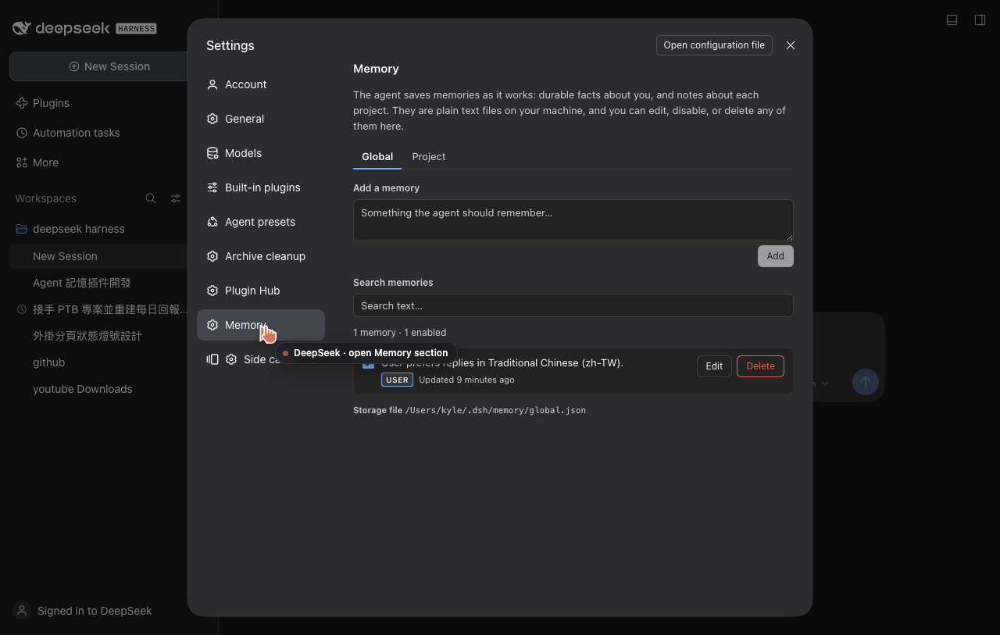
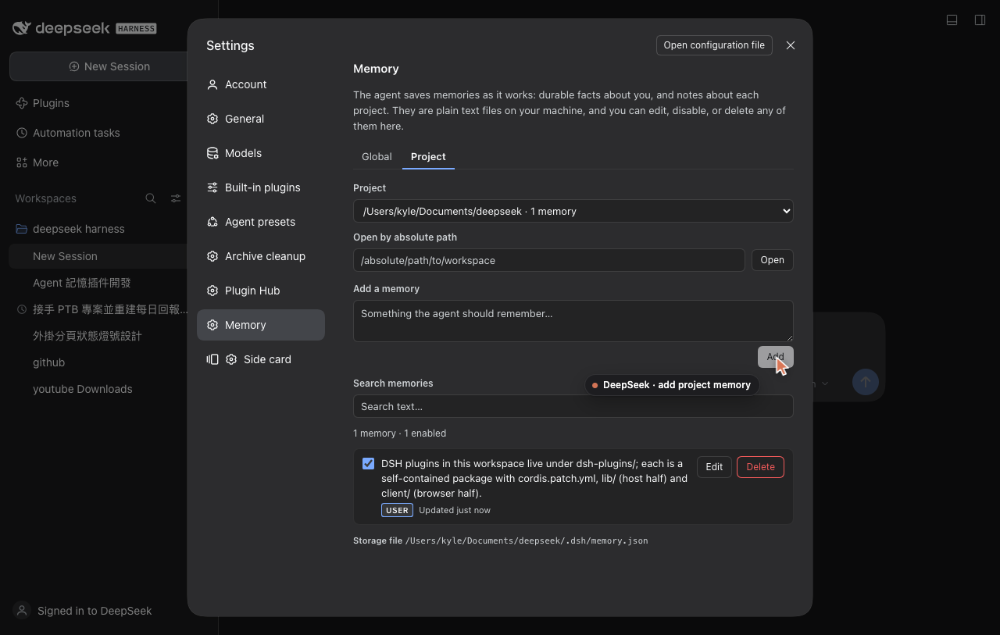

# dsh-agent-memory

[](https://www.npmjs.com/package/@kyle2241345145351324321/dsh-agent-memory)
[](LICENSE)
[](test)
[](https://github.com/deepseek-ai/deepseek-harness)

**給 DeepSeek Harness agent 的長期記憶。** 像 Claude 的記憶一樣：agent 自己把值得記住的事存起來，你在
**Settings → Memory** 看得到、改得動、刪得掉。記憶只留在這台機器上，不會上傳到任何地方。

- **全域記憶** — 關於你的事實與偏好（語言、口氣、長期規則、個人背景），所有對話共用。
- **專案記憶** — 關於某個工作區的事實（慣例、架構決策、可用的指令、踩過的雷），存在專案裡，
  可以進 git、可以用編輯器直接改。
- **Agent 透過 `memory` 工具寫入** — 對話中出現長期偏好、修正、專案知識時自己存；
  **你在設定頁也能手動新增/編輯/停用/刪除**，兩邊看到的是同一份資料。
- **兩份純文字 JSON 檔**，沒有資料庫、沒有雲端、沒有遙測。

## 安裝

從 npm 安裝（會自動把 loader row 插進 profile）：

```sh
dsh plugin --profile web add @kyle2241345145351324321/dsh-agent-memory
```

或直接從 GitHub 安裝（尚未發佈時）：

```sh
dsh plugin --profile web add github:kyle2241345145351324321/dsh-agent-memory
```

本機開發時用 `link:` 連到這個資料夾：

```sh
dsh plugin --profile web add link:/Users/kyle/Documents/deepseek/dsh-plugins/dsh-agent-memory
```

**重開一次 `dsh web` 是必要的。** 新的 loader row 會被 live patch 掛上，但**host 端程式碼的變更
（以及安裝／更新外掛本身）要重開 `dsh web` 才會生效**——這跟 DSH 其他外掛更新一樣（Plugin Hub 顯示
「待重啟生效」）。設定頁的 UI 是 client bundle，重新整理頁面即會載入；記憶檔則完全即時。





## 使用

1. 開 **Settings → Memory**（設定面板左側會多一個「記憶 / Memory」分頁）。
2. **Global** 分頁：跨專案的記憶。**Project** 分頁：先選一個專案（或貼上專案路徑按 Open），
   就能看/改那個專案的記憶。
3. 直接跟 agent 說「記住我偏好繁體中文回覆」、「記住這個專案的測試指令是 pnpm test」之類的話，
   agent 會呼叫 `memory` 工具存起來。想確認有沒有存到，看同一個設定頁就好。
4. 任何一筆都可以：勾選框停用（不進 prompt，但保留）、Edit 改文字、刪除、或上面搜尋框過濾。

停用（unchecked）的記憶仍然留在檔案裡，只是不會被注入到 agent 的 prompt——想暫時關掉某一條又不想刪，就用它。

## 記憶存在哪

| 範圍 | 路徑 |
| --- | --- |
| 全域 | `$DSH_HOME/memory/global.json`（預設 `~/.dsh/memory/global.json`） |
| 專案 | `<專案>/.dsh/memory.json` |
| 專案索引 | `$DSH_HOME/memory/projects.json`（設定頁的專案清單；不是記憶本體） |

格式就是普通 JSON，可以直接用編輯器改；外掛用 mtime 偵測變更，改完下一輪就會生效。寫入是
atomic（暫存檔 + rename），不會寫壞檔案。如果檔案被改成無效 JSON，外掛會回報錯誤而不是覆蓋它。

```json
{
  "version": 1,
  "memories": [
    {
      "id": "m_m5x2k_9af31c",
      "text": "User prefers replies in Traditional Chinese.",
      "enabled": true,
      "source": "agent",
      "createdAt": "2026-11-11T16:00:00.000Z",
      "updatedAt": "2026-11-11T16:00:00.000Z"
    }
  ]
}
```

專案記憶放在專案裡是刻意的：它跟程式碼一起 version control、code review、被同事看到。不想讓它進
git 就在 `.gitignore` 加 `.dsh/`。

## Agent 的介面

工具 `memory`：

| 參數 | 說明 |
| --- | --- |
| `action` | `add` / `list` / `search` / `update` / `remove` |
| `text` | add/update 的內容（一句、self-contained、最長 2000 字） |
| `id` | update/remove 的目標；id 會出現在 prompt 的記憶快照與 list 結果裡 |
| `scope` | `global` 或 `project`；在專案裡預設 `project`，否則 `global` |
| `query` | `search` 的關鍵字（不分大小寫） |
| `enabled` | `update` 用：`false` 保留但不注入 |

Agent 每輪看到的內容分成兩塊：固定的「怎麼用記憶」instructions（system prompt section），加上
目前啟用中的記憶快照（動態 prompt context，帶 id）。你改了記憶，下一個 request 就會用新版，不用重開。

## 設定

loader row 的 `config` 可以覆寫（全部可選）：

```yaml
- insert:
    - id: dsh-agent-memory
      name: 'dsh-agent-memory'
      config:
        home: /custom/dsh-home      # 覆寫 $DSH_HOME（測試或搬家用）
        maxPromptChars: 6000        # 注入 prompt 的字元上限，超過的條目會省略並註明
        maxEntries: 200             # 單一檔案最多幾條
        maxEntryChars: 2000         # 單條最長字元
```

## 開發 / 測試

改完 `lib/` 的程式碼後，重開 `dsh web` 讓 host 載入新版本（`node_modules/dsh-agent-memory` 是指向
這個資料夾的 symlink，所以不用重新複製）。只改 `client/client.js` 則重新整理頁面即可。外掛刻意
不匯入任何 `@deepseek-ai/*` 套件，因此不需要安裝依賴、也不需要建置步驟。

不用建置、沒有第三方依賴（只有 node 內建模組）：

```sh
cd /Users/kyle/Documents/deepseek/dsh-plugins/dsh-agent-memory
npm test          # 等於 node --test "test/*.test.mjs"
```

測試（Node only、零依賴）：store 讀寫與 mtime 快取、記憶 CRUD 規則、prompt 渲染與預算、
HTTP 契約、tool 定義與 output 契約、host 掛載整合（section / context / tool / route）、
client bundle 契約（id / NS / settings.section 註冊）。

檔案結構：

| 路徑 | 內容 |
| --- | --- |
| `lib/index.js` | cordis plugin：prompt section + context、`memory` 工具、掛 route |
| `lib/store.js` | JSON 檔讀寫、atomic write、mtime 快取、專案索引 |
| `lib/memory.js` | 驗證與 CRUD（工具和 HTTP 共用同一套規則） |
| `lib/render.js` | prompt 快照渲染、instructions 文案 |
| `lib/routes.js` | `/dsh-agent-memory` 的 JSON API（Fetch Request/Response，好測） |
| `client/client.js` | 手寫的 browser bundle：Settings → Memory 分頁 |
| `test/` | store / render / routes / tool 測試 |

## 發佈 / Plugin Hub

套件已可發佈：`@kyle2241345145351324321/dsh-agent-memory`（scoped、public），分類 `memory`。
npm 發佈、GitHub repo、Plugin Hub 送審的完整步驟見 [PUBLISHING.md](PUBLISHING.md)；
版本紀錄見 [CHANGELOG.md](CHANGELOG.md)。

```sh
npm login                # 帳號 kyle2241345145351324321
npm publish              # publishConfig.access 已設 public
```

## 隱私

記憶只寫在本機檔案（上面兩個路徑），也只在本機被讀進 prompt。沒有網路請求、沒有帳號、沒有分析。
要清掉全部記憶：刪掉 `~/.dsh/memory/` 與各專案的 `.dsh/memory.json`；或在設定頁逐條刪除。

## 解除安裝

```sh
dsh plugin --profile web remove dsh-agent-memory
```

再從 `~/.dsh/profiles/web/cordis.patch.yml` 移除那個 insert row。記憶檔不會被刪除。

---

## English

`@kyle2241345145351324321/dsh-agent-memory` — durable memory for DeepSeek Harness agents, in the spirit
of Claude's memory feature.

- **Global memory** — stable facts and preferences about the user, shared by every session. Stored at
  `$DSH_HOME/memory/global.json`.
- **Project memory** — facts about one workspace (conventions, decisions, commands, gotchas). Stored in
  `<workspace>/.dsh/memory.json`, so it can be reviewed and committed with the code.
- **The agent writes through a `memory` tool** (`add` / `list` / `search` / `update` / `remove`), and the
  user can add, edit, disable, or delete every entry in **Settings → Memory**.
- **Plain JSON, no cloud, no telemetry.** Writes are atomic and serialized; reads are mtime-cached, so a hand
  edit reaches the next request without a restart.

Install:

```sh
dsh plugin --profile web add @kyle2241345145351324321/dsh-agent-memory
# restart dsh web once; then refresh the browser page
```

Tests are Node-only and dependency-free: `npm test`. Design contract: [DESIGN.md](DESIGN.md).
Publishing and Plugin Hub submission: [PUBLISHING.md](PUBLISHING.md).


